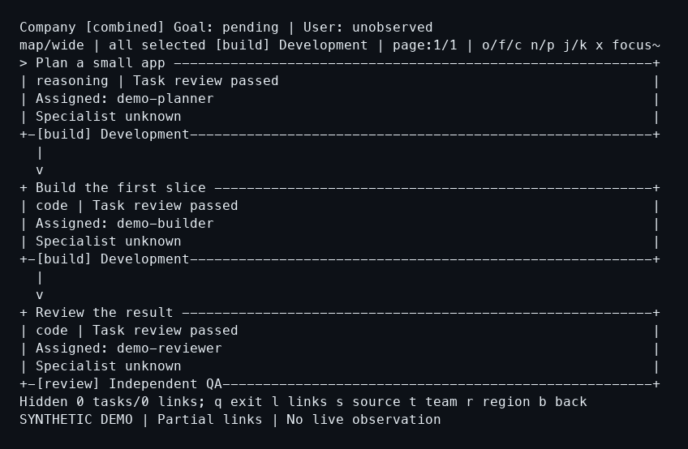

# Agent Company for Orca

## Give your app work a team, not another chat thread.

**Turn an app goal into owned work, visible dependencies and independently reviewed results.**

Agent Company is a terminal-native operating layer for Orca: planning, design,
development, marketing and QA/release working toward one outcome. Orca runs the
workers; Company supplies the coordination rules. You keep control of goals,
spending and publication.

[Try the no-model demo](#try-it-before-you-install) · [Install](#install-in-orca) · [First real task](#your-first-real-task) · [Docs](#go-deeper)

<picture>
  <source media="(max-width: 600px)" srcset="assets/readme/company-demo-narrow.png">
  
</picture>

*Real shipped TUI, synthetic records, no model execution.* The narrow image shows
part of the same paged map. [Text version](assets/readme/company-demo.txt) ·
[Full-size view](assets/readme/company-demo-wide.png) ·
[What this demo proves](skills/company-orchestration/assets/demo/README.md)

- **One goal, explicit owners.** Turn an unfinished idea into bounded contributions
  and observable completion criteria—not a mandatory cast of agents.
- **Work you can follow.** Keep recognizable task cards, exact assigned model IDs
  and recorded dependencies in a resident terminal view. Unknown evidence stays unknown.
- **Review is a separate job.** Workers do not approve their own work. Passing task
  checks does not automatically approve the overall outcome.

## Try it before you install

**No API key, Orca connection or Company installation required.** You need Git and
[uv](https://docs.astral.sh/uv/getting-started/installation/). uv can obtain Python
3.13 if it is missing; prepare it ahead of time for offline use.

```sh
git clone --single-branch https://github.com/JoonSCode/agent-company-distribution.git
cd agent-company-distribution
uv run --no-project --python 3.13 python scripts/agent_company_demo.py --once
```

**First success:** a checked three-task map ending with
`SYNTHETIC DEMO | Partial links | No live observation`. Nothing is installed,
no configuration is changed and no model is called. The `demo-*` model IDs are
illustrative, not provider models. The synthetic task reviews pass while the
overall goal remains pending.

Then explore the actual resident viewer in your terminal:

```sh
uv run --no-project --python 3.13 python scripts/agent_company_demo.py
```

`j`/`k` select · `x` focus · `w` wide map · `o`/`f`/`c` views · `n`/`p` pages · `q` quit.
The viewer refreshes supplied records; the bundled example is static, not a
simulation of live work. English ASCII is the demo default and works on light
or dark terminals. The original Unicode/Korean presentation is available with
`--unicode --palette dark` for a dark terminal; there is no automatic theme detection.

Already have Python 3.13? `python3 scripts/agent_company_demo.py --once` needs no
extra Python packages. [Demo inputs and usage](skills/company-orchestration/assets/demo/README.md)
are bundled with the distribution.

## Install in Orca

To coordinate real work, you also need an Orca host supporting your chosen agent,
Bash and a working agent sign-in. The managed native role files and completion
hook target Codex; Claude Code direct has an explicit skill entry. Service
selection is intent, not authentication or a promise of every runtime adapter.
The Bash installer is not a native Windows installer; the optional updater uses macOS.

From the same persistent checkout, inspect the revision and preview configuration:

```sh
git rev-parse HEAD
git checkout --detach HEAD
bash install.sh install --dry-run --no-input --services codex
bash install.sh install
```

The preview does not apply changes. Interactive setup lets you choose services;
fresh defaults keep **API-paid execution and the updater off**. It applies package
files and reports **runtime verification pending**—not a successful agent run.
Review hook trust and agent readiness, then open a new Orca session. Keep the
source checkout: updates and recovery need its Git identity, not a snapshot copy.

<details>
<summary>Explicit non-interactive installation</summary>

```sh
bash install.sh install --no-input --yes --preset single --services codex --updater off --api-paid off --json
```

This writes the managed package and private user configuration. It does not sign
in, launch workers or make a paid API call. Review the dry-run first. For other
service choices and native-runtime checks, follow the
[setup guide](skills/company-orchestration/references/getting-started.md).

</details>

## Your first real task

In a new Codex session, invoke `$agent-company`; for the installed Claude Code
entry, use `/agent-company`. Start with a bounded, read-only request:

> Read the installed Company entry and resolved configuration. Propose three
> improvements to this repository, with reasons and a check for each. Do not edit
> files, launch additional workers or publish anything.

This step uses your authenticated agent; **it is not the no-model demo**. Company
should establish scope and success criteria before you authorize implementation.
An unfinished idea is enough to start—you do not need to write a full spec first.

## From a goal to a checked result

1. **Agree on the outcome.** Clarify material choices, constraints and evidence of success.
2. **Assign the smallest useful team.** Match responsibilities, models and effort to
   the actual task; six role areas do not mean six mandatory workers.
3. **Work and integrate.** Specialists bring source-backed results to the responsible
   owner. Organization, task dependencies and assignments are distinct from observed execution.
4. **Review independently.** Check the integrated result, settle worker resources
   and retained evidence, and verify the original goal—not just individual tasks.

Orca owns actual Tasks, Dispatches and messages. A Task is the work; a Dispatch
is an attempt. Company does not replace Orca with a web dashboard and needs no
external King Sejong Core installation. It does not promise autonomous business
results, measured speedups or automatic provider readiness.

## Go deeper

| You want to… | Start here |
| --- | --- |
| Configure services, presets and private overrides | [Configuration](skills/company-orchestration/references/configuration.md) |
| Understand the entry and six specialist role areas | [Company entry](skills/agent-company/SKILL.md) · [Roles](agents/) |
| See staffing, evidence and integration rules | [Operating policy](skills/company-orchestration/SKILL.md) |
| View your own records and navigate the task map | [Terminal view](skills/company-orchestration/references/status-tui.md) |
| Understand the actual execution boundary | [Orca contract](skills/company-orchestration/references/orca-contract.md) |
| Diagnose installation or recover a generation | [Setup and recovery](skills/company-orchestration/references/getting-started.md) |
| Inspect exactly what ships | [Public inventory](PUBLIC_INVENTORY.txt) · [Release notes](CHANGELOG.md) |

### Update, recover or remove

Use the persistent source checkout. Preview before applying changes:

```sh
uv run --script scripts/agent_company_installer.py update --dry-run
bash scripts/update.sh
# If needed, inspect the previous retained package before restoring it.
uv run --script scripts/agent_company_installer.py rollback --dry-run
# Preview removing managed package files.
uv run --script scripts/agent_company_installer.py uninstall --dry-run
```

Update installs the selected local source revision; it is not an implicit
`git pull`. Review and select the intended source revision first. Rollback restores
retained package files, not provider readiness or historical runtime behavior.
Private configuration and user-owned additions have separate preservation rules;
[read the recovery guide](skills/company-orchestration/references/getting-started.md)
before applying rollback or uninstall.

## Help and contribute

[Open an issue](https://github.com/JoonSCode/agent-company-distribution/issues)
with the version, expected behavior and a redacted error. Do not include
credentials, personal paths or real task traces. This repository is the
installable runtime projection: maintainers change the canonical source and
regenerate it, rather than editing managed installed files.

[MIT](LICENSE) · [Third-party notices](THIRD_PARTY_NOTICES.md)
