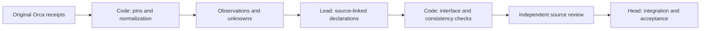

# Organization evidence replay

`../scripts/org_audit.py` provides read-only receipt import and the existing
event audit beside the [record checker](record-contract.md). Multi-team work
must retain the five-stage source evidence required by the Company policy;
this helper is a way to reduce repeated entry, not a required new execution layer.
It reads original Orca JSON receipts and an explicit handoff or event manifest.
It does not launch workers, update an organization, enforce
hierarchy, or replace `record.json`. Keep both the originals and prior manifests.
No existing completion check invokes it automatically.

The tool separates Task creator, worker executor, requested actor and accountable
owner. A creator or `parent_id` never supplies an owner or team. Event kind,
team membership, decision meaning and owner acceptance require source review.
Even an exact matching JSON field does not prove a meaningful discussion occurred.
A hash verifies bytes against the supplied pin; it does not authenticate their
origin. `host_observed` means an operator supplied a recognized host receipt,
not cryptographic authentication. Transcript extractions remain
`extracted_observation`; supplementary facts remain `claimed`.

## Canonical AI-to-code handoff

Use one explicit, versioned input for new receipt imports. The schema name is
`company-org-handoff`, with integer `version: 1`. This is an interface contract,
not a second execution record or a replacement for role-specific handoffs or
`record.json`. Do not add a wrapper/scheduler to collect the same state again.

```json
{
  "schema": "company-org-handoff",
  "version": 1,
  "coverage": "partial",
  "sources": [
    {
      "id": "example-task",
      "path": "task-create.json",
      "format": "orca_task",
      "provenance": "Original task-create stdout captured by the operator"
    }
  ],
  "declarations": []
}
```

This example is synthetic. Store actual inputs and outputs privately in the
owning Run. Paths resolve relative to the handoff. Only the listed files are
read; import does not recursively scan directories or fetch network sources.

| Input | Type and boundary |
|---|---|
| `schema`, `version` | Exact schema string and integer 1; other versions or types are rejected |
| `coverage` | `partial` or `declared_complete`; completeness is still an operator claim |
| `sources` | Array of explicit source objects, each with nonempty `id`, `path`, supported `format` and `provenance` |
| Source `sha256` | Optional expected SHA-256; when supplied it must match the original bytes; otherwise import computes and returns their pin |
| Source `captured_at`, `host_id` | Optional nonempty string or null; caller-declared metadata, never proof of occurrence or origin |
| `declarations` | Array using the event vocabulary below: `id`, `kind`, `evidence`, optional `depends_on`, and canonical nullable fields |

Unknown keys and malformed types are rejected at this boundary. Missing evidence,
unknown identities and partial capture remain visible in the structured result.
An input hash calculated during import records the bytes read; it does not prove
those bytes were already reviewed or authenticate a host. Preserve optional
expected pins when the input must match a previously accepted candidate.

```sh
uv run --no-project --python 3.13 python /path/to/company-orchestration/scripts/org_audit.py import /private/run/org-handoff.json > /private/run/org-import.json
```

Output uses `schema: "company-org-import"`, integer `version: 1`, `status`,
`coverage`, pinned `sources`, normalized `observations`, `draft_events`,
`declarations`, `issues` and `limits`. Each receipt row supplies a draft event
with its exact observation reference and receipt kind. Unknown semantic fields
stay null. Import copies no message body, Task spec or payload into the result.
No output is written by the tool itself; stdout redirection is an operator action.
The positional v1 manifest replay command below remains supported.
Malformed input uses the existing structured error variant
`{"status":"invalid_input","error":"reason"}` and exit 2. This variant contains
no observations and does not claim a successful import schema.

The code checks types, versions, original byte hashes, IDs, source pointers,
supported envelope shapes and contradictions. AI or a human decides what a
discussion meant, which team owns an outcome, whether the exact scope/revision
was accepted, and whether evidence is sufficient. Put those interpretations in
`declarations` with original observation references; their event kind remains
`claimed`, while `field_status` retains each field's observed, claimed or unknown
basis. Matching metadata can substantiate identity but never certify the event kind or
meaning. Creator, executor, requester and accountable owner remain different fields.



The arrows describe evidence use, not automatic approval. The owner reads the
original discussion before declaring meaning; independent review does not become
optional because the interface check passed.

## Capture and run

Use the exact executable and read-only flags confirmed by the current Orca guide.
For a known Run, the currently supported capture commands are:

```sh
orca orchestration task-list --run "$RUN_ID" --json > tasks.capture.json
orca orchestration worker-list --run "$RUN_ID" --json > workers.capture.json
```

Use new filenames for each capture. Keep original task-create/worker-start/error
receipts as well: inventory snapshots do not provide their mutation request IDs.
Check worker-list `result.page.hasMore` and `nextCursor`; capture subsequent pages
with the current host's documented cursor flags. Check task-list truncation/cursor
metadata too when present. A first page never establishes completeness. The
helper emits `incomplete_capture` for remaining cursors, hasMore, truncation or a
total larger than the observed page. Missing explicit terminal page metadata is
`capture_coverage_unknown`, even under `declared_complete`. An unpaginated host
contract or a complete multi-page chain still needs source review; this helper
does not infer their completeness from a count or silently merge them.
Do not repeat a writer just to obtain another receipt. Keep captures/manifests and
reports in the private Run directory, outside this public repository. Outputs can
contain identifiers, source paths and declared facts; they are not public exports.

Run with standard-library Python 3.13 (no dependency install):

```sh
uv run --no-project --python 3.13 python /path/to/company-orchestration/scripts/org_audit.py /private/run/org-events.json > /private/run/org-audit.json
uv run --no-project --python 3.13 python -m unittest discover -s /path/to/company-orchestration/scripts -p test_org_audit.py -v
```

Exit 0 means recorded fields are consistent with linked evidence, 1 means an
invalid or contradictory record, 2 means malformed/unreadable manifest, and 3
means incomplete evidence. Exit 3 is a visible unknown, not evidence that the
workflow did not occur. Exit 0 never proves CEO/team/member behavior or acceptance.

## Manifest

The input has `version:1`, `coverage:"partial"` or `"declared_complete"`,
`sources:[]`, `events:[]`, and `expected_events:[]` (event IDs). Declared completeness
is the operator's inventory claim, not independent proof that all events were
captured. A missing expected ID is `missing_event`. An empty event list stays unknown.

Each source has `id`, `path`, `sha256`, `format`, and `provenance` (nonempty text).
Compute the SHA256 from original bytes, for example with `shasum -a 256 receipt.json`.
Paths resolve relative to the manifest; absolute paths work. Optional `captured_at`
is the actual capture time or null when unknown. Optional `host_id` is the observed
host identifier or null. Preserve the original occurrence time separately;
file modification time and capture time never become an occurrence timestamp.
The receipt's `_meta.runtimeId`, when present, namespaces identities. Otherwise
`host_id` does; without either, cross-source identity consistency remains unknown
and sources are kept separate. Metadata values are caller declarations.

| `format` | Recognized shape | Evidence basis |
|---|---|---|
| `orca_tasks` | Successful envelope `result.tasks[]` | Host receipt |
| `orca_task` | Successful envelope `result.task` | Host receipt |
| `orca_workers` | Successful envelope `result.workers[]` | Host receipt |
| `orca_launch` | Successful envelope with Run/Task/Dispatch, mutation, effects | Host receipt |
| `orca_error` | Failed envelope `error.code`, `error.data.orchestrationRequestId` | Host receipt |
| `orca_messages` | Successful check/inbox envelope `result.messages[]`, metadata only | Host receipt |
| `orca_message` | Successful captured send envelope `result.message`, metadata only | Host receipt |
| `message_extract` | `messages[].message` with id/run_id/from_handle/to_handle/created_at | Transcript extraction |
| `owner_acceptance` | scope/revision/accepted_by, optional terminal/task/dispatch/time | Supplementary claim |
| `claims` | `claims[]` with unique `id` and canonical fields below | Supplementary claim |

Other envelopes require an explicit reviewed adapter; they are not silently
searched for convenient strings. An unsupported shape cannot become evidence.
Message bodies/spec text, mutable worker status, and English assertions are not
parsed as decisions, ownership, or proof of results. Exact source pointer/hash
lets a reviewer read that original context without copying transcripts here.

Each event has a unique `id`, nonempty `kind` (an interpretation), `evidence:[]`
(observation refs), optional `depends_on:[]` (event IDs), and these required keys.
Use null for an unknown or inapplicable value; it remains visibly unknown:

```json
{
  "id": "example-launch", "kind": "launch",
  "run_id": "example-run", "scope": null, "revision": null,
  "actor": null, "accountable_owner": null, "team_id": null,
  "decision_id": null, "task_id": "example-task",
  "dispatch_id": "example-dispatch", "request_id": "example-request",
  "occurred_at": null, "executed_by": "example-member",
  "evidence": ["launch#/result"], "depends_on": []
}
```

This is a synthetic shape example, not a recorded execution. Optional canonical
fields are `requested_by`, `executed_by`, `message_id`, `recipient`, `created_by`,
`parent_task_id`, `from_team`, `to_team`, and `error_code`. These retain cross-team
requests and proxy boundaries without deciding whether a route is authorized.
Claim sources use the same field names. Unsupported event fields are rejected;
use the original source for richer rationale and counterevidence.

Observation refs are `source-id#` plus the exact JSON pointer: task snapshots use
`#/result/tasks/0`, task-create uses `#/result/task`, worker snapshots use
`#/result/workers/0`, launches use `#/result`, errors use `#/error`, extracted
messages use `#/messages/0/message`, owner acceptance uses `#`, and supplementary
claims use `#/claims/0`. First run with `events:[]` to list normalized observations,
then link the relevant rows. That discovery run intentionally exits 3.

Use one event per occurrence. A task-create request and a worker-start request
have different request IDs; model them separately, with `depends_on` if supported
by the original evidence. Link only rows describing that event. Attach an owner
acceptance as its own event: its Task/Dispatch may identify the head's assignment,
rather than the child's Task. Richer source relationships require human review.

## Interpret and maintain

The JSON report retains source pins/provenance, normalized facts, event claims,
field-level basis and issue codes. `missing_*`/`unknown_field` identify absent
information; `unsupported_claim` has no matching normalized evidence. These are
unknowns. `claim_only` is supported solely by supplementary material: it remains
an unverified claim, but matching a pinned claim source is not itself an error.
Thus exit 0 can include `claimed` fields; inspect their basis before making any
statement about actual behavior.
`contradiction`/`claim_contradiction` disagree with linked rows;
`identity_contradiction` detects conflicting stable identities across captures.
Repeated identical identities across snapshots are allowed; duplicate identities
inside a snapshot, manifest or event inventory are invalid. Out-of-order arrivals
are allowed. Only explicit missing dependencies and dependency cycles are checked;
there is no invented global chronology or inference from array order.

For new work, reuse saved Task/Dispatch/message mutation receipts and bounded
read-only captures through the import handoff. It generates byte pins, normalized
IDs and exact observation references so the operator does not type them twice.
Only material owner/team/decision/acceptance meaning needs a source-linked
declaration. Do not repeat a writer to obtain an omitted receipt or infer meaning
from array order, actor labels or `parent_id`.

Keep a compact expected inventory of the five stages for an actual multi-team
claim: independent lead proposals and head synthesis; exact team scope acceptance;
member feasibility then concrete assignment; execution and parent integration;
cross-team lead request/response. Link actual source refs and keep missing/unknown
stages visible. The helper does not award a five-stage completion verdict. The
head and independent reviewer own that assessment on the exact candidate.

Subsequent snapshots remain new sources rather than replacements of originals.
The remaining limitation is semantic omission: import cannot recover a decision
that the owner never recorded or prove a discussion was meaningful. Reuse existing
handoffs/receipts; do not create a second execution state store or synthetic meeting
transcripts. Host recording or enforced lead-to-lead routing requires a separate
approved integration and real-run review.
